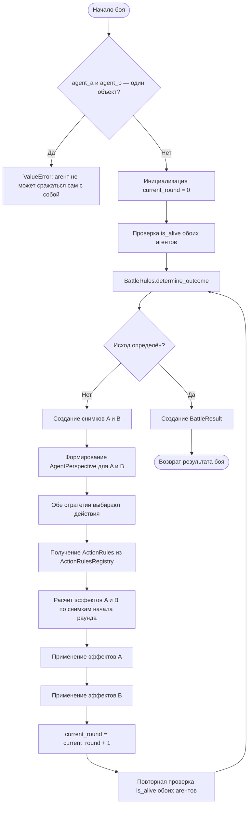
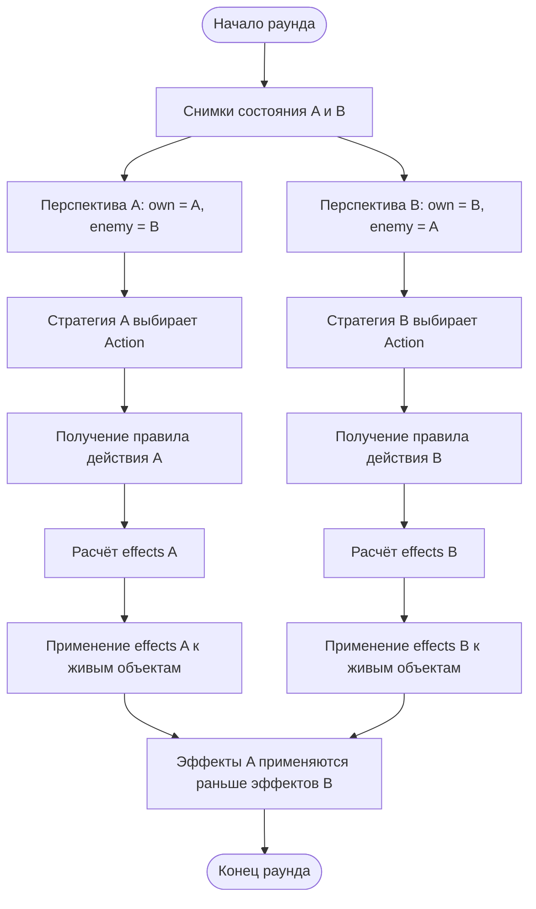
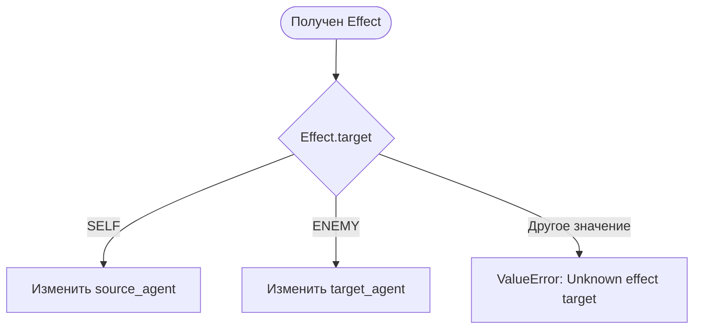
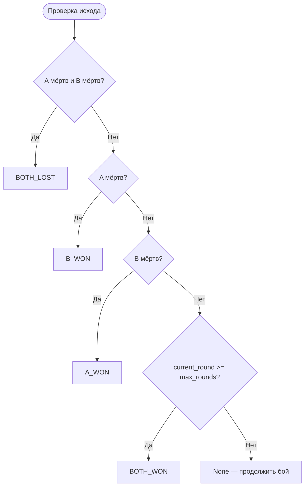

# Принципиальная схема боя

Схема отражает фактический алгоритм `BattleEngine.start_battle()`.

## Общий поток

## Последовательность внутри одного раунда

## Маршрутизация эффекта

Каждый `Effect` указывает получателя через `target`:

## Проверка завершения боя

`BattleRules.determine_outcome()` проверяет условия строго в следующем порядке:

## Важные свойства алгоритма

1. **Обе стороны принимают решение по снимкам одного и того же начала раунда.** Изменения, нанесённые в текущем раунде, не меняют уже выбранные действия и рассчитанные эффекты.
2. **Эффекты рассчитываются до начала их применения.** Сначала рассчитывается набор A, затем набор B; только после этого начинается изменение агентов.
3. **Применение не одновременное.** Сначала применяются эффекты A, затем B. Поэтому порядок важен, если эффекты взаимодействуют нелинейно.
4. **Смерть не отменяет уже выбранное действие.** Если эффекты A убили B, ранее рассчитанные эффекты B всё равно применяются.
5. **Раунд завершается после применения обоих наборов эффектов.** Только затем увеличивается счётчик и проверяется исход.
6. **Приоритет исходов:** сначала проверяется смерть обоих, затем смерть A, затем смерть B, и только после этого лимит раундов. Поэтому при одновременной смерти результат — `BOTH_LOST`, даже если достигнут лимит.
7. **`BOTH_WON` — не ничья.** Это исход, при котором оба агента живы, но достигнут лимит раундов.

## Граница гарантии

Алгоритм не обеспечивает транзакционность раунда. Если исключение возникнет во время применения эффектов, изменения, уже применённые к агентам, не откатываются. Также последовательное применение означает, что эффекты B могут увидеть состояние объектов после применения эффектов A, если логика их применения читает текущее состояние.
